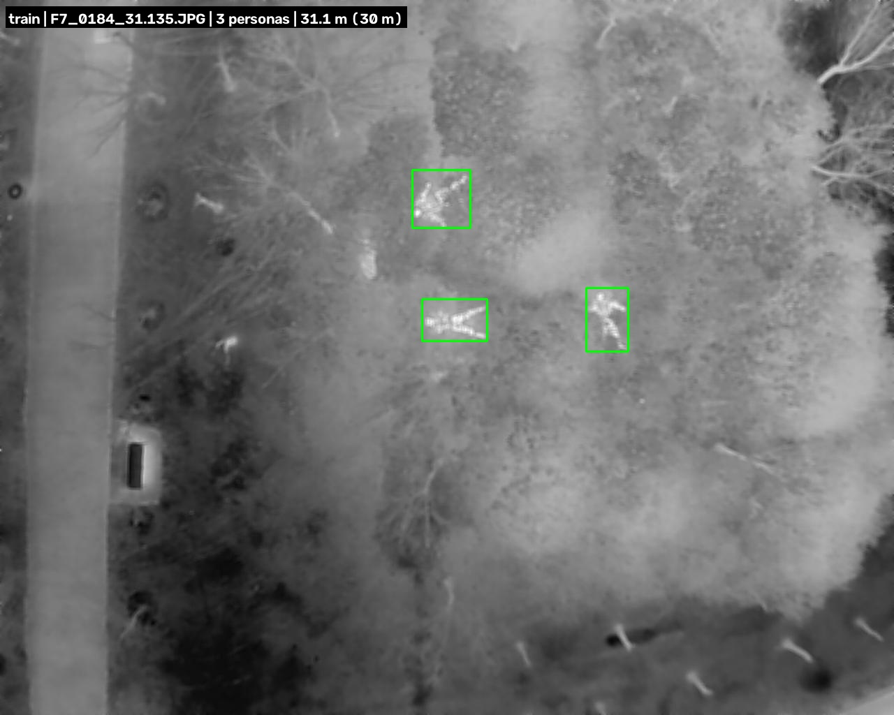
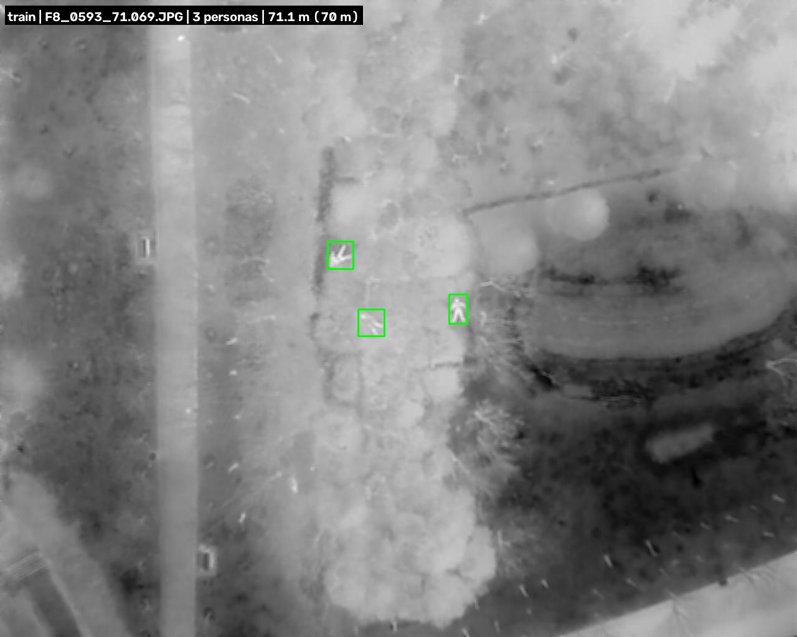
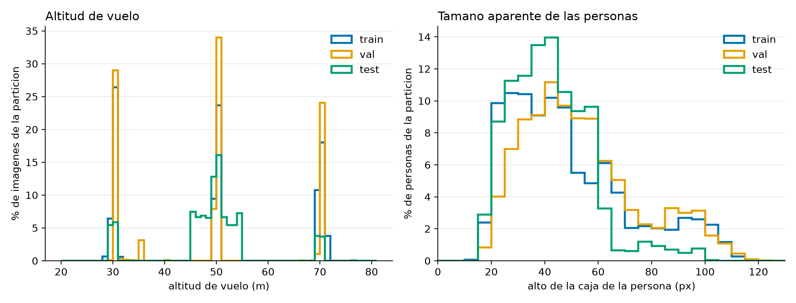
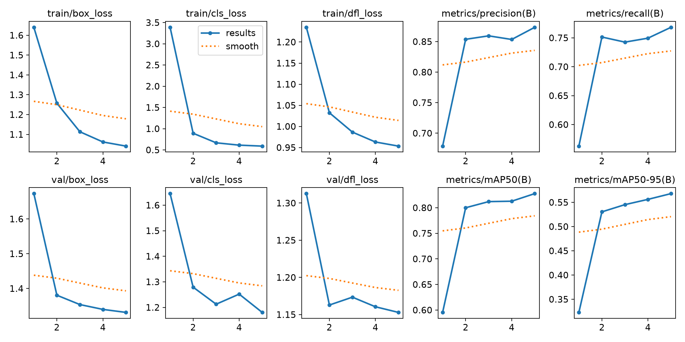
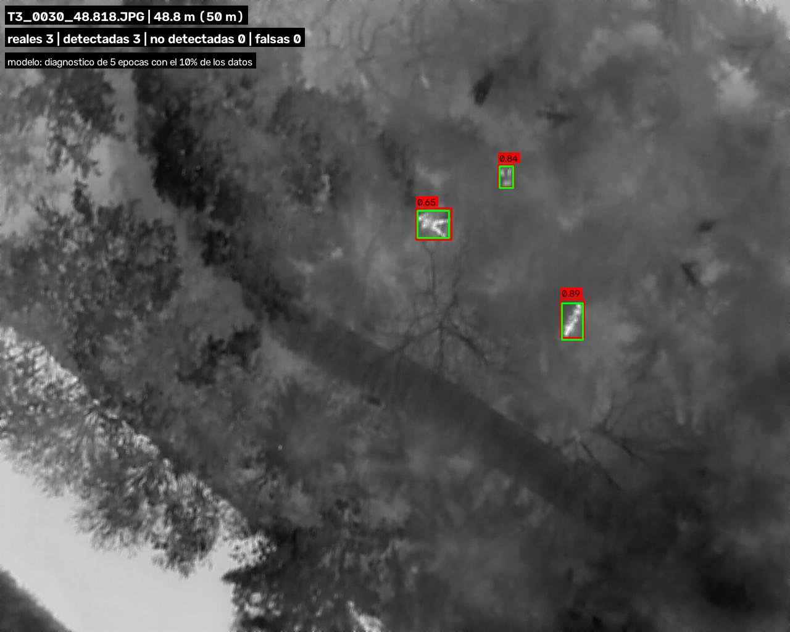
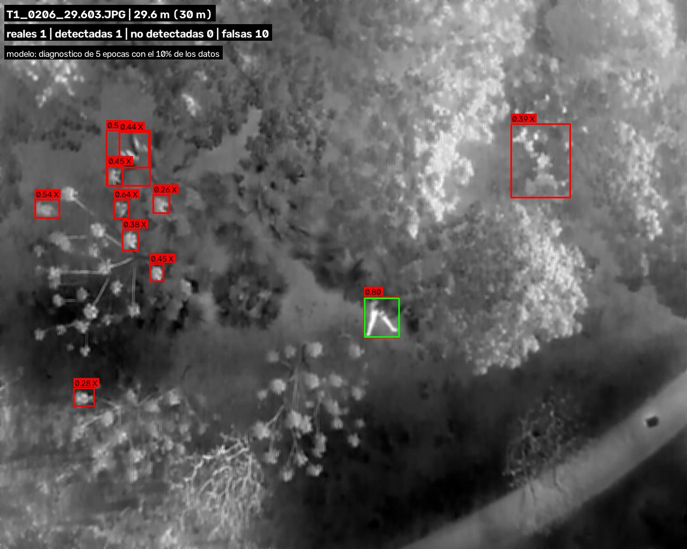
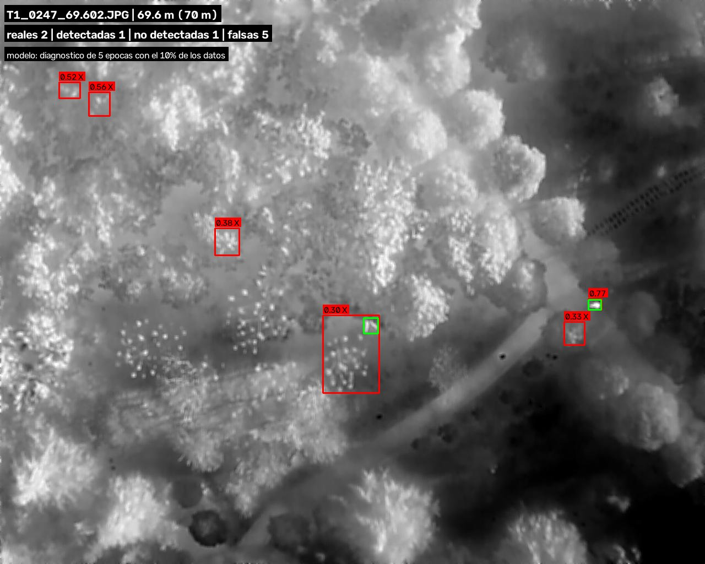

# Buscar personas tapadas por la vegetación, desde un dron

Tesis de pregrado en Ingeniería de Sistemas, Universidad de Lima.
Curso Seminario de Investigación I. Avance a octubre de 2026.

---

## 1. El problema

Cuando alguien se pierde en un bosque, los equipos de rescate usan drones para buscarlo desde el aire. El problema es que los árboles tapan a la persona: desde arriba se ve el follaje, no a quien está debajo. Una cámara normal apenas sirve, porque todo es verde. Una cámara térmica, que fotografía el calor en lugar de la luz, ve mejor a la persona porque el cuerpo está más caliente que el entorno, pero tampoco atraviesa la vegetación densa.

Esta investigación estudia **cómo combinar las dos cámaras** para encontrar a más personas. La pregunta es cuál de las tres formas de combinarlas funciona mejor, y sobre todo cuál aguanta mejor cuando la persona está muy tapada.



Así se ve una imagen térmica desde un dron a 31 metros. Las tres manchas claras marcadas en verde son personas tendidas entre la vegetación: el calor del cuerpo las delata aunque a simple vista no se distingan.

---y 

## 2. Qué hace este código

```
Datos originales  ->  Preparar  ->  Entrenar  ->  Evaluar  ->  Resultados
```

- **Datos originales.** Miles de fotos de dron donde alguien ya marcó a mano, con un rectángulo, dónde está cada persona.
- **Preparar.** Traducir esas marcas al formato que entiende el programa de entrenamiento, y ordenar las fotos en tres grupos.
- **Entrenar.** Mostrarle al detector miles de fotos con sus respuestas correctas, una y otra vez, hasta que aprenda a encontrar personas solo.
- **Evaluar.** Ponerle un examen con fotos que nunca vio y calificarlo, por separado según la altura a la que volaba el dron.
- **Resultados.** Tablas e imágenes que muestran en qué acierta y en qué se equivoca.

---

## 3. Cómo está organizado

| Carpeta | Qué contiene |
|---|---|
| `configs/` | Los ajustes de cada experimento: qué fotos usar, cuántas vueltas dar, qué tamaño de imagen. Nada de esto está escrito dentro del código, para que cambiar un experimento no signifique tocar programas. |
| `data/` | Las fotos. No se suben al repositorio porque pesan gigabytes. |
| `src/` | Las piezas de código que se reutilizan en varios lugares. |
| `scripts/` | Los programas que se ejecutan, en el orden de las secciones siguientes. |
| `runs/` | Lo que produce cada entrenamiento. Tampoco se sube: son archivos grandes. |
| `reports/` | Las tablas y figuras que van al artículo. Esto sí se sube, y es lo que se ve en este README. |
| `experiments/bitacora.csv` | El cuaderno de laboratorio: una fila por cada entrenamiento y cada evaluación, con su fecha, su configuración y sus resultados. |

---

## 4. Paso a paso

### 4.1 `env_info.py` — dejar constancia de la computadora

- **Para qué:** un mismo programa puede dar resultados distintos en máquinas distintas. El artículo tiene que decir con qué equipo se trabajó.
- **Recibe:** nada; le pregunta a la propia computadora.
- **Produce:** un informe con el sistema, las versiones y el modelo de tarjeta gráfica. Avisa si la tarjeta gráfica no está disponible, que es el error más común al instalar todo en una máquina nueva.
- **Se ejecuta:** `python scripts/env_info.py`

### 4.2 `pop_explorar.py` — mirar los datos antes de tocarlos

- **Para qué:** revisar con los ojos que las marcas caen sobre las personas. Es el paso que más errores evita: si las marcas estuvieran corridas, todo lo demás estaría mal sin que nos diéramos cuenta.
- **Recibe:** las fotos y marcas originales. No las modifica.
- **Produce:** un resumen de cuántas fotos y personas hay, y diez fotos de muestra con las personas marcadas, en `reports/pop_muestras/`.
- **Se ejecuta:** `python scripts/pop_explorar.py`

### 4.3 `pop_preparar.py` — traducir las marcas

- **Para qué:** las marcas vienen en un formato llamado COCO y el programa de entrenamiento solo entiende otro, llamado YOLO. Este script traduce de uno al otro.
- **Recibe:** las fotos y marcas originales.
- **Produce:** las fotos listas para entrenar, la lista de todas las personas del dataset (`personas.csv`), la tabla de cuántas hay a cada altura y los dos gráficos que describen el dataset.
- **Se ejecuta:** `python scripts/pop_preparar.py`

### 4.4 `train.py` — entrenar al detector

- **Para qué:** el paso donde el programa aprende, mirando miles de ejemplos.
- **Recibe:** un archivo de ajustes de `configs/`, que describe el experimento completo.
- **Produce:** el modelo entrenado, las curvas de aprendizaje y una fila nueva en la bitácora.
- **Se ejecuta:** `python scripts/train.py --config configs/exp1_pop_termico.yaml`

### 4.5 `eval_estratos.py` — poner el examen y calificar

- **Para qué:** medir cuánto acierta, pero separado por altura de vuelo. Un solo número para todo esconde lo que de verdad interesa.
- **Recibe:** un modelo entrenado y las fotos del examen final, que el modelo nunca vio.
- **Produce:** `reports/exp1_resultados.csv` con los resultados generales y los de cada altura, y una fila en la bitácora.
- **Se ejecuta:** `python scripts/eval_estratos.py`

### 4.6 `pop_predicciones.py` — ver qué está haciendo el detector

- **Para qué:** las tablas dicen cuánto acierta; estas figuras muestran en qué acierta y en qué falla.
- **Recibe:** un modelo entrenado y las fotos del examen.
- **Produce:** seis fotos marcadas en `reports/predicciones/`, tres de aciertos y tres de errores, y una copia de las curvas de entrenamiento.
- **Se ejecuta:** `python scripts/pop_predicciones.py`

---

## 5. Resultados hasta hoy

> **Antes de leer los números.** Lo que sigue salió de una prueba pequeña hecha en una computadora personal: el detector entrenó con solo el **10 % de las fotos** y dio **5 vueltas** en vez de 100. Sirve para comprobar que todo el proceso funciona de principio a fin. **Todavía no es la réplica del 0.87 publicado** por los autores del dataset; esa corrida necesita el equipo del laboratorio y está pendiente.

### 5.1 Cómo son los datos



- **Qué se ve:** la misma escena de la portada, pero con el dron a 71 metros en lugar de 31.
- **Cómo leerla:** los rectángulos verdes son las personas marcadas a mano por quienes armaron el dataset.
- **Qué nos dice:** a esa altura cada persona ocupa unos 20 píxeles, menos que esta letra "o" en la pantalla. Esa es la dificultad central del problema.

El dataset completo, llamado POP, tiene **8768 fotos** con **26 810 personas marcadas**, repartidas en tres grupos:

| Grupo | Para qué sirve | Fotos | Personas |
|---|---|---|---|
| Entrenamiento | aprender | 5548 | 18 425 |
| Validación | revisar el avance | 2320 | 6 545 |
| Prueba | el examen final | 900 | 1 840 |

Es como estudiar con unos ejercicios y rendir el examen con otros que nunca se vieron. Además, cada grupo viene de lugares de vuelo distintos, así que el modelo tampoco puede aprenderse el paisaje de memoria.

### 5.2 Qué contiene el dataset



- **Qué se ve:** dos gráficos. El de la izquierda, a qué alturas voló el dron. El de la derecha, de qué tamaño se ven las personas en las fotos.
- **Cómo leerla:** cada color es uno de los tres grupos. El eje vertical es el porcentaje dentro de cada grupo, no la cantidad, porque los grupos tienen tamaños muy distintos.
- **Qué nos dice:** los vuelos se hicieron a tres alturas (30, 50 y 70 metros), salvo en el grupo de prueba, que barre de 45 a 55 metros. Y las personas del examen se ven más pequeñas que las del entrenamiento, así que el examen es más exigente que la práctica.

### 5.3 El entrenamiento



- **Qué se ve:** cómo cambió el detector a lo largo de las cinco vueltas.
- **Cómo leerla:** las curvas de arriba a la izquierda son el error: tienen que **bajar**. Las de la derecha son la calificación: tienen que **subir**.
- **Qué nos dice:** el error de reconocer personas cayó de 3.39 a 0.61 y la calificación subió parejo. El detector efectivamente aprendió; el proceso funciona.

Al terminar esas cinco vueltas, el modelo se midió con las 2320 fotos de validación:

| Medida | Valor | Qué significa |
|---|---|---|
| Nota general (mAP@0.5) | 0.828 | de 0 a 1, combina las dos medidas de abajo |
| Precisión | 0.874 | de cada 100 rectángulos que dibujó, 87 eran personas de verdad |
| Recall | 0.769 | de cada 100 personas que había, encontró 77 |

### 5.4 El examen final, separado por altura

Estos son los resultados sobre las 900 fotos de prueba, las que el modelo nunca vio:

| Altura del dron | Fotos | Personas | Nota (mAP@0.5) | Precisión | Recall |
|---|---|---|---|---|---|
| **Todas juntas** | 900 | 1840 | **0.600** | 0.653 | 0.542 |
| 30 metros | 102 | 102 | 0.745 | 0.305 | 0.873 |
| 50 metros | 731 | 1604 | 0.618 | 0.731 | 0.536 |
| 70 metros | 67 | 134 | 0.530 | 0.807 | 0.373 |

- **Qué nos dice:** la nota baja conforme el dron sube, de 0.745 a 0.530. Cuanto más alto vuela, más difícil es encontrar a alguien.
- **Y algo más fino:** a 30 metros el detector encuentra a 87 de cada 100 personas, pero de cada 100 rectángulos que dibuja solo 30 son personas: se confunde mucho con manchas calientes de vegetación. A 70 metros pasa lo contrario: casi no se equivoca cuando afirma algo (81 de cada 100), pero se le escapan dos de cada tres personas. En búsqueda y rescate eso es lo grave: una persona no encontrada es una persona que sigue perdida.
- **Cuidado con esos dos extremos:** las filas de 30 y 70 metros tienen solo 102 y 134 personas. Con tan pocos casos, los números se mueven mucho y no conviene sacar conclusiones firmes.

**Comprobación de que la calificación es correcta:** el mismo modelo se midió dos veces, una con nuestro propio código y otra con el del programa de entrenamiento, que son programas independientes. Dieron 0.5997 y 0.5990. Esa coincidencia indica que la forma de medir es confiable.

### 5.5 Qué está viendo el detector

En las tres figuras siguientes, **verde = persona real** y **rojo = lo que el detector creyó ver**, con su nivel de confianza de 0 a 1. Una `X` marca una falsa alarma.



- **Qué se ve:** una foto donde el detector acertó del todo.
- **Cómo leerla:** cada rectángulo rojo rodea a uno verde, y ninguno sobra.
- **Qué nos dice:** encontró a las tres personas, con confianzas de 0.65 a 0.89, y no inventó nada.



- **Qué se ve:** una foto donde el detector encontró a la persona pero marcó otras diez cosas.
- **Cómo leerla:** los rectángulos rojos con `X` son las falsas alarmas.
- **Qué nos dice:** confunde manchas de vegetación caliente con personas. Es el error típico de un modelo entrenado poco tiempo, y debería reducirse con el entrenamiento completo.



- **Qué se ve:** una foto tomada a 70 metros con dos personas, de las cuales el detector encontró una.
- **Cómo leerla:** el rectángulo verde sin rojo alrededor es la persona que se le pasó.
- **Qué nos dice:** es el caso que más importa de esta investigación. A mayor altura, el detector pierde personas, y justamente para eso se quiere sumar la segunda cámara.

---

## 6. Un hallazgo: los datos no traían lo que la literatura decía

El objetivo de la tesis es comparar el desempeño según **cuánto tapa la vegetación** a cada persona. Para calcular eso hace falta saber qué parte del cuerpo se ve y qué parte queda escondida, y eso requiere que alguien haya dibujado la silueta exacta de cada persona, no solo un rectángulo alrededor.

Los artículos que describen este dataset mencionan esa información. **Al revisar los archivos, no está.** Se verificó por cuatro caminos distintos:

1. Las 26 811 marcas del dataset tienen el campo de la silueta vacío, sin excepción.
2. En todo lo descargado solo hay fotos y archivos de marcas: ningún archivo de siluetas.
3. En el repositorio oficial del dataset solo se publican tres archivos, y ninguno las contiene.
4. El propio artículo, leído con cuidado, dice que esa medición se hizo en un experimento aparte, con video, y que **no se anotó persona por persona**.

Encontrar esto a tiempo evitó construir todo el estudio sobre un dato que no existe. Mientras se consulta a los autores del dataset, el análisis se hace separando por altura de vuelo, que sí se puede obtener: viene escrita en el nombre de cada archivo.

---

## 7. Qué falta

| Pendiente | Por qué todavía no está |
|---|---|
| La corrida completa, de 100 vueltas y con todas las fotos | Necesita la computadora del laboratorio: en la PC personal tardaría unos dos días. |
| El segundo dataset, WiSARD, que sí tiene cámara normal y térmica emparejadas | Son 40 GB y hay que descargarlos y revisarlos primero. |
| Las tres formas de combinar las dos cámaras | Es el experimento central, y requiere el paso anterior. |
| La información de cuánto tapa la vegetación a cada persona | Explicado en la sección 6. A la espera de respuesta de los autores del dataset. |

---

## 8. Las herramientas que se usan y por qué

Nada de esto se programó desde cero. El proyecto usa programas ya existentes, cada uno para una tarea distinta. La idea es la misma que al construir una casa: uno no fabrica los ladrillos.

### Las dos piezas centrales

| Herramienta | Qué hace | Por qué se eligió |
|---|---|---|
| **PyTorch** 2.14.1 | Es el motor de cálculo donde vive y aprende la red neuronal. Todo lo demás se apoya en él. | Es el estándar en investigación de inteligencia artificial, y es lo que usa por dentro el detector que elegimos. Se instala en su versión para tarjeta gráfica (CUDA 12.6), que hace los cálculos decenas de veces más rápido que el procesador. |
| **Ultralytics** 8.4.176 | Trae el detector YOLOv8 ya construido: lo entrena, lo mide y guarda las curvas de aprendizaje. Es lo que se ejecuta en `train.py`. | Es la implementación oficial de YOLOv8, y es la misma que usaron los autores del dataset POP. Usar la misma herramienta es lo que permite comparar nuestro resultado con el 0.87 que ellos publicaron. Sin esto habría que programar una red neuronal entera. |

### Para medir los resultados

| Herramienta | Qué hace | Por qué se eligió |
|---|---|---|
| **pycocotools** 2.0.11 | Califica al detector: compara lo que encontró con lo que había y calcula la nota (mAP). Se usa en `eval_estratos.py`. | Es la herramienta con la que se califican los detectores en los artículos científicos, así que nuestra nota es comparable con la de cualquier otro trabajo. Además permite marcar personas como "ignorar", que es justo lo que hace falta para medir por separado cada nivel de oclusión. |

### Para manejar imágenes, tablas y archivos

| Herramienta | Qué hace | Dónde se usa |
|---|---|---|
| **OpenCV** 5.0.0.93 | Abre las fotos, dibuja los rectángulos y los textos encima, y las vuelve a guardar. | En todas las figuras de este README. En la fase 5 se usará además para encajar la foto normal sobre la térmica. |
| **NumPy** 2.4.6 | Trabaja con listas de números grandes y rápidas. Una foto, para la computadora, es exactamente eso: una tabla de números. | Es la base sobre la que están construidos OpenCV y PyTorch; nosotros la usamos directamente para las siluetas. |
| **pandas** 3.0.6 | Maneja tablas, como una hoja de cálculo pero escrita en código. | Para armar `personas.csv` (26 810 filas) y las tablas de `reports/`. |
| **matplotlib** 3.11.2 | Dibuja gráficos. | La figura de distribuciones de la sección 5.2. |
| **PyYAML** 6.0.3 | Lee los archivos de la carpeta `configs/`. | En todos los scripts. El formato YAML se eligió porque se lee como texto normal: cualquiera puede abrir un experimento y entender sus ajustes sin saber programar. |

### Dos que están instaladas pero todavía no usamos directamente

Por honestidad, conviene decirlo:

- **SciPy** 1.17.1 — herramientas de matemática científica. No aparece en nuestro código: la necesita Ultralytics por dentro. Está en la lista para dejar fijada su versión y que el laboratorio instale exactamente la misma.
- **thop** 0.1.1 — cuenta cuántas operaciones hace un modelo para procesar una imagen. Se usará en la fase final, donde hay que comparar no solo qué tan bien detecta cada uno de los cinco modelos, sino cuánto cuesta ejecutarlo.

### Por qué PyTorch no está en `requirements.txt`

Es el único programa que se instala aparte, y por un motivo concreto: si estuviera en esa lista, el instalador bajaría la versión que **solo usa el procesador**, y la tarjeta gráfica quedaría sin aprovechar. Hay que pedirlo explícitamente en su versión con CUDA, como se ve en la sección 10.

---

## 9. Glosario

| Término | Explicación |
|---|---|
| Dataset | Colección de imágenes donde una persona ya marcó a mano dónde está cada persona. |
| Imagen térmica | Foto que capta el calor en lugar de la luz. Las personas se ven claras porque están más calientes que el entorno. |
| Imagen RGB | Foto normal, en color, como la de un celular. |
| Caja | Rectángulo que marca dónde está una persona en la imagen. |
| Etiqueta o anotación | Las cajas que dibujó una persona. Son la "respuesta correcta" con la que se compara al modelo. |
| Modelo o detector | Programa que aprende a encontrar personas mirando muchos ejemplos. |
| YOLOv8s | El detector que usamos. "YOLO" es la familia de detectores; la "s" indica la versión pequeña y rápida. |
| Pesos preentrenados | El modelo ya aprendió antes a reconocer objetos comunes con millones de fotos. Partimos de ahí en lugar de empezar de cero. |
| Entrenar | Mostrarle al modelo miles de imágenes con sus respuestas para que aprenda a encontrar personas solo. |
| Época | Una vuelta completa por todas las imágenes de entrenamiento. |
| Lote | Cuántas imágenes mira el modelo a la vez antes de corregirse. |
| Pérdida | Medida de cuánto se equivoca el modelo mientras aprende. Si baja, está aprendiendo. |
| Particiones | El dataset se divide en tres grupos. Entrenamiento: para aprender. Validación: para revisar el avance y ajustar. Prueba: el examen final, con imágenes que el modelo nunca vio. |
| Confianza | Qué tan seguro está el modelo de que una caja es una persona, de 0 a 1. |
| Precisión | De todas las cajas que marcó el modelo, qué parte eran personas de verdad. Si es baja, hay muchas falsas alarmas. |
| Recall | De todas las personas que había, qué parte encontró el modelo. Si es bajo, se le escapan personas. En búsqueda y rescate es lo más importante. |
| mAP@0.5 | Nota general del detector, de 0 a 1, que combina precisión y recall. El "0.5" significa que una caja cuenta como acierto si coincide al menos a la mitad con la caja real. |
| Altitud | Altura a la que volaba el dron. A más altura, las personas se ven más pequeñas. |
| Oclusión | Qué parte del cuerpo de la persona tapa la vegetación. |
| GPU | Tarjeta gráfica. Hace los cálculos del entrenamiento mucho más rápido que el procesador normal. |
| Semilla | Número que fija el azar del entrenamiento, para que repetirlo dé el mismo resultado. |
| Intervalo de confianza | Rango donde probablemente está el valor real. Si hay pocos datos, el rango es más ancho y el número es menos seguro. |
| Falsa alarma | Una caja que el modelo dibujó donde no había ninguna persona. |
| Calentamiento | Al empezar a entrenar, el modelo aprende a propósito muy despacio durante las primeras vueltas, para no arruinar lo que ya sabía. |
| Formato COCO y formato YOLO | Dos maneras distintas de anotar en un archivo dónde está cada persona. Guardan lo mismo, escrito diferente. |
| Enlace duro | Un segundo nombre para un archivo que ya existe en el disco. Permite tener la misma foto en dos carpetas sin ocupar el doble de espacio. |

---

## 10. Cómo repetirlo

**Los datos** (no se incluyen en el repositorio, hay que descargarlos):

- POP, el dataset térmico que se usa en este avance: [osf.io/kmcva](https://osf.io/kmcva) — 613 MB. Va en `data/raw/pop`.
- WiSARD, el dataset con cámara normal y térmica emparejadas, para las siguientes fases: [sites.google.com/uw.edu/wisard](https://sites.google.com/uw.edu/wisard) — 40.5 GB el archivo completo, o 972 MB la muestra de un solo vuelo. Va en `data/raw/wisard`.

**La instalación**, una sola vez por computadora:

```bash
# Un entorno aislado, para que las versiones de este proyecto no choquen con
# las de otros trabajos de la misma máquina.
conda create -n sar python=3.11 -y
conda activate sar

# PyTorch con soporte de tarjeta gráfica. Va aparte y con esta dirección
# expresa; desde el instalador normal vendría la versión lenta, solo procesador.
pip install torch torchvision --index-url https://download.pytorch.org/whl/cu126

# El resto de las herramientas de la sección 8.
pip install -r requirements.txt
```

**Los comandos**, en orden:

```bash
conda activate sar
python scripts/env_info.py                 # comprobar que la tarjeta gráfica está disponible
python scripts/pop_explorar.py             # revisar los datos
python scripts/pop_preparar.py             # traducir las marcas y generar las tablas
python scripts/train.py --config configs/exp1_pop_termico_prueba.yaml   # prueba corta
python scripts/eval_estratos.py            # calificar
python scripts/pop_predicciones.py         # generar las figuras
```

Para la corrida completa del laboratorio, el único cambio es el archivo de ajustes:

```bash
python scripts/train.py --config configs/exp1_pop_termico.yaml
```

Todos los experimentos usan la semilla 0, así que repetirlos da el mismo resultado.

---

## Créditos

Las imágenes térmicas provienen del dataset **POP**, publicado con licencia [CC-BY 4.0](https://creativecommons.org/licenses/by/4.0/) en [osf.io/kmcva](https://osf.io/kmcva):

> Song, Z., Yan, Y., Cao, Y., Jin, S., Qi, F., Li, Z., Lei, T., Chen, L., Jing, Y., Xia, J., Liang, X., & Lu, G. (2025). An infrared dataset for partially occluded person detection in complex environment for search and rescue. *Scientific Data*. https://doi.org/10.1038/s41597-025-04600-0

El dataset **WiSARD**, que se usará en las siguientes fases:

> Broyles, D., Hayner, C. R., & Leung, K. (2022). WiSARD: A Labeled Visual and Thermal Image Dataset for Wilderness Search and Rescue. *IEEE/RSJ International Conference on Intelligent Robots and Systems (IROS)*. https://arxiv.org/abs/2309.04453

El plan completo por fases está en [FASES.md](FASES.md) y las reglas de trabajo del proyecto en [REGLAS.md](REGLAS.md).
